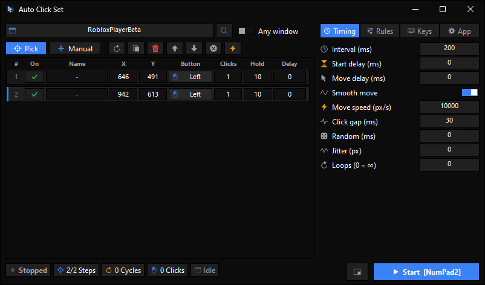

 

# ScuffedCreation

*A collection of lightweight Windows tools.*

| Tool | Description | Preview | Download |
|:---|:---|:---:|:---:|
| ⚡ **Auto Click Set** | Automate mouse clicks with customizable positions and timing. |  | [**↗ Get**](https://github.com/Krusdy/ScuffedCreation/releases/tag/Auto-Click-Set) |
| 🎮 **Discord Quest Dummy** | Automate Discord Quest progress. |  | [**↗ Get**](https://github.com/Krusdy/ScuffedCreation/releases/tag/Discord-Quest) |
| 🎬 **Media Processor** | Convert and process video, audio, and image files. |  | [**↗ Get**](https://github.com/Krusdy/ScuffedCreation/releases/tag/Media-Processor) |
| 🖱️ **Mouse Motion Blur** | Customizable mouse cursor motion blur and visual effects. |  | [**↗ Get**](https://github.com/Krusdy/ScuffedCreation/releases/tag/Mouse-Movement-Motion-Blur) |
| 🚀 **Priority Manager** | Manage process priorities for better system control. |  | [**↗ Get**](https://github.com/Krusdy/ScuffedCreation/releases/tag/Priority-Manager) |
| ⏸️ **Progress Freezer** | Freeze or pause application progress. |  | [**↗ Get**](https://github.com/Krusdy/ScuffedCreation/releases/tag/Progress-Freezer) |
| 🧰 **Powerful Toys** | A collection of useful system utilities and tools. |  | [**↗ Get**](https://github.com/Krusdy/ScuffedCreation/releases/tag/Powerful-Toys) |
| 🎮 **Roblox Multi-Client Anti-AFK** | Prevent Roblox clients from going AFK. |  | [**↗ Get**](https://github.com/Krusdy/ScuffedCreation/releases/tag/Roblox-Multi-Client-Anti-AFK) |
| 🖥️ **Screen Tuner** | Customize and manage screen settings. |  | [**↗ Get**](https://github.com/Krusdy/ScuffedCreation/releases/tag/Screen-Tuner) |
| 🎵 **Spotify Playlist Fetcher** | Fetch and retrieve Spotify playlist information. |  | [**↗ Get**](https://github.com/Krusdy/ScuffedCreation/releases/tag/Spotify-Playlist-Fetcher) |
